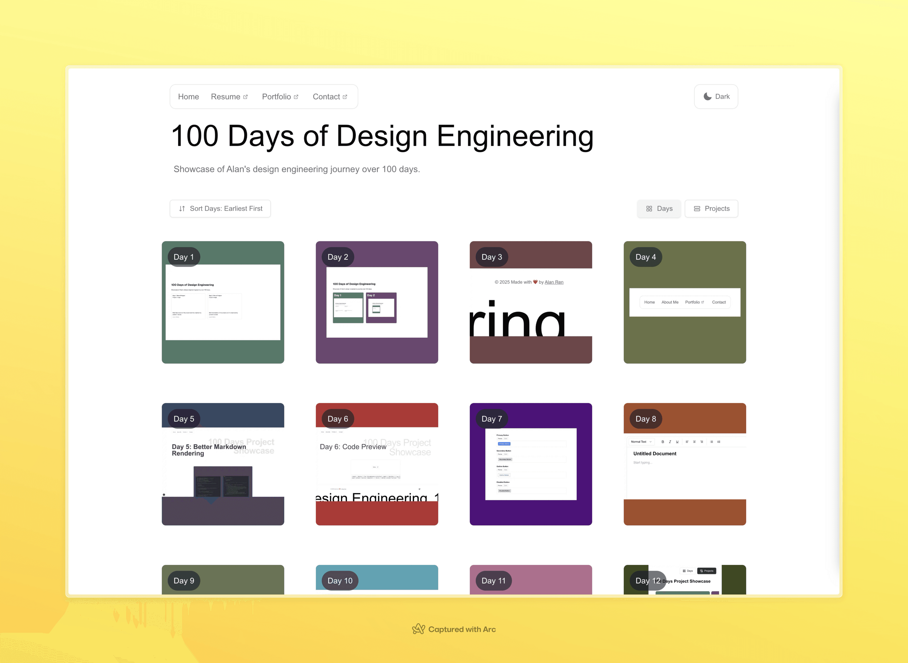
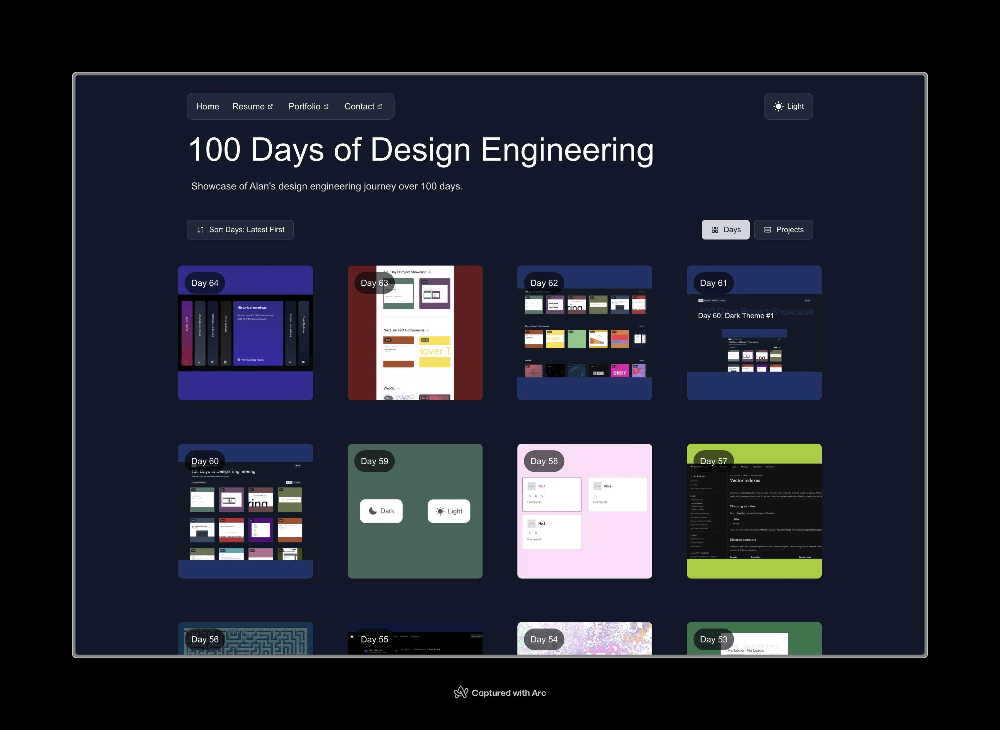
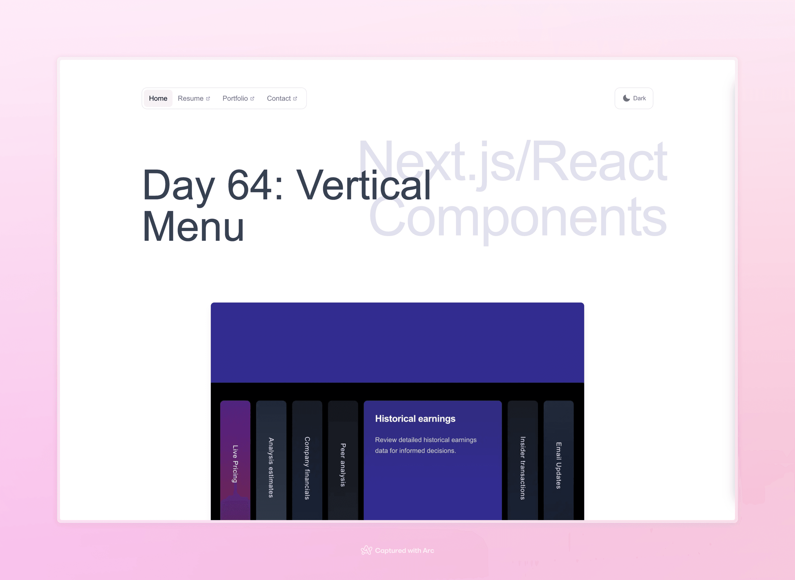
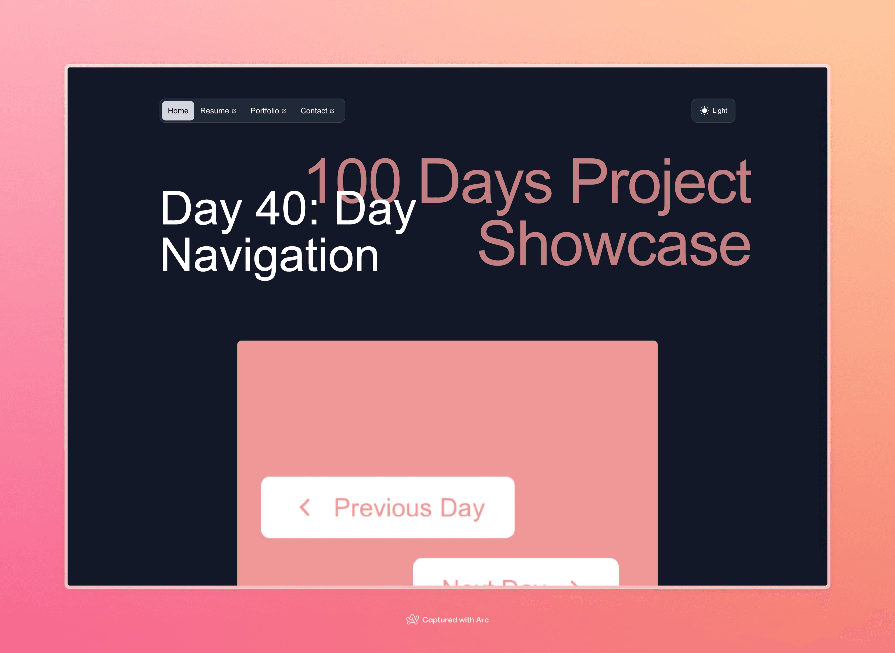

Built during the *100 Days of Making* studio at NYU ITP (Spring 2025), **100 Days of Design Engineering** ([`100days.alan.ooo`](https://100days.alan.ooo/)) is a living monorepo and interactive archive of daily design engineering experiments. Rather than treating UI design and frontend engineering as separate handoff stages, each daily build ships a self-contained, production-grade component, shader study, or full-stack micro-application in **Next.js, React, TypeScript, Tailwind CSS, and WebGL**.

---

## Four Tracks of Daily Exploration

Across the semester, the daily builds converged around four recurring themes:

1. **Interactive UI Primitives & Micro-Interactions**: Tactile navigation patterns, keyboard-first pagination controls (**Day 40**), multi-state theme toggles, rich-text document editors (**Day 11–12**), and spatial accordion menus (**Day 64**).
2. **Real-Time WebGL & Shader Studies**: Procedural 3D scenes, hologram maze shaders (**Day 55**), particle fields, and post-processing pipelines integrated into standard React DOM layouts.
3. **Developer Tooling & Documentation Systems**: Custom Markdown/MDX loaders (**Day 1–3**), live code-preview sandboxes (**Day 5**), and vector-indexed documentation search (**Day 57**).
4. **Full-Stack Feedback & Telemetry Widgets**: Lightweight API endpoints and persistent feedback controls embedded directly into interactive prototypes.

---

## Archive Index & Selected Daily Builds

<ImageGrid cols={2} caption="Chronological archive views and individual daily component studies on 100days.alan.ooo">
  
  
  
  
</ImageGrid>

## Architecture of the Archive

To prevent 60+ heterogeneous experiments—ranging from raw Three.js canvases to server-backed React forms—from colliding or bloating a single bundle, the repository ([`alanvww/100-Days-of-Design-Engineering`](https://github.com/alanvww/100-Days-of-Design-Engineering)) isolates each day under dynamic route segments (`/[slug]/page.tsx`) with lazy-loaded component boundaries, shared typography tokens, and unified keyboard navigation across the entire catalog.
