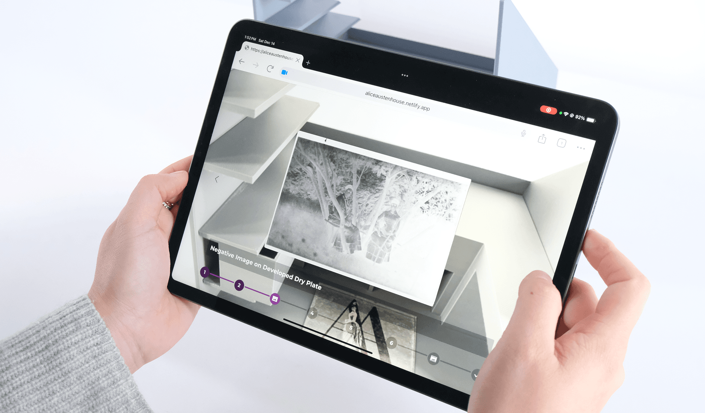
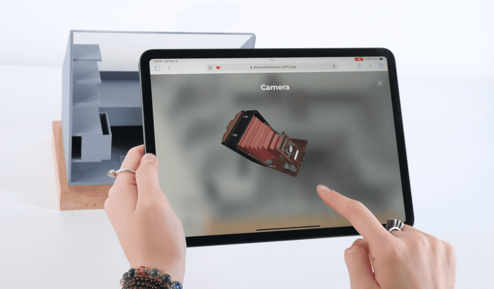
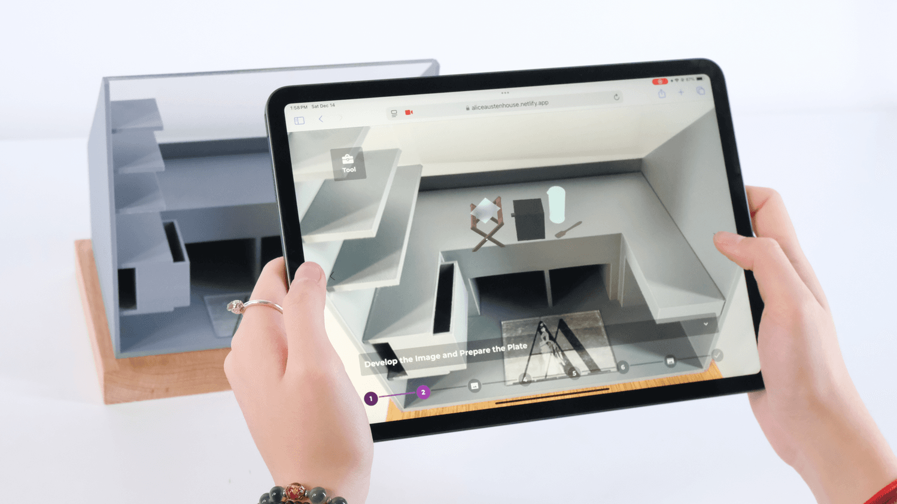
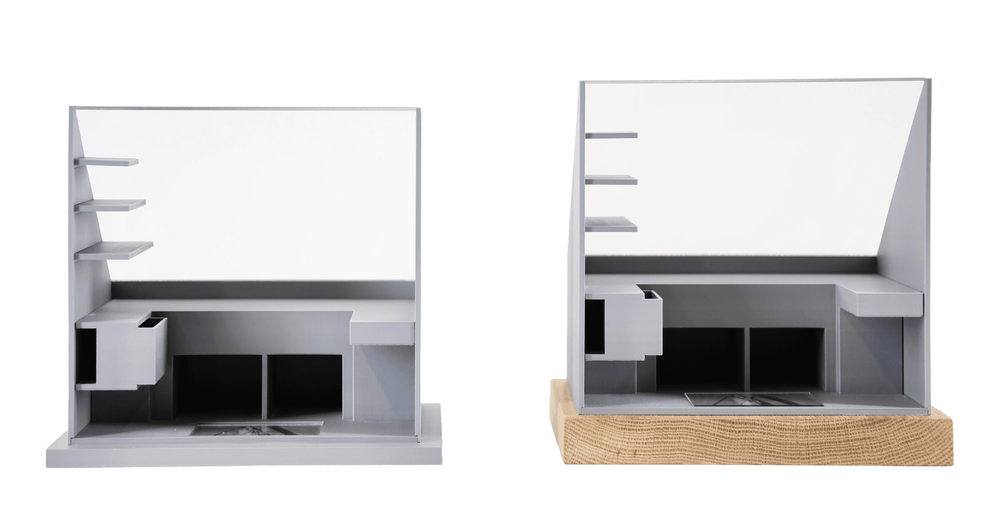

Developed in partnership with the **Alice Austen House Museum** in Staten Island, NY, *A Peek Through the Dark Room* reimagines the museum's historic second-floor photographic darkroom—an architectural space where pioneering photographer Alice Austen (1866–1952) developed thousands of glass-plate negatives, but which remains physically inaccessible to visitors unable to climb the narrow nineteenth-century staircase.

To bring the second-floor darkroom down into the accessible first-floor gallery, our team designed a multi-sensory exhibition system combining **tactile architectural reliefs**, **two 1:12 scale physical darkroom models**, and a **browser-based WebAR plate-development experience** ([`aliceaustenhouse.netlify.app`](https://aliceaustenhouse.netlify.app/)).

---

## Engineering & Exhibition Deliverables

1. **Browser-Based WebAR Darkroom Experience ([`AAH-WebAR`](https://github.com/alanvww/AAH-WebAR))**: I engineered the companion mobile web and WebAR application (`aliceaustenhouse.netlify.app`), allowing museum visitors to scan markers on their smartphones without installing a native app, peer inside a virtual reconstruction of Austen's workspace, and interactively step through nineteenth-century glass-plate negative chemical development under virtual safelight illumination.
2. **1:12 Scale Physical Darkroom Models**: Two precision-fabricated 1:12 miniature reconstructions of the historic darkroom interior, complete with miniature developing trays, period cabinetry, glass plates, and embedded warm/red safelight LEDs that invite visitors to look through a physical peephole.
3. **Tactile Staircase Reliefs**: A sequence of laser-cut and 3D-printed tactile architectural reliefs installed along the first-floor staircase wall, translating the darkroom's exterior carpentry and spatial layout into touchable surfaces for blind and low-vision visitors.

<ImageGrid cols={2} caption="1:12 scale darkroom models, tactile staircase reliefs, and mobile WebAR experience at the Alice Austen House Museum">
  
  
  
  
</ImageGrid>
