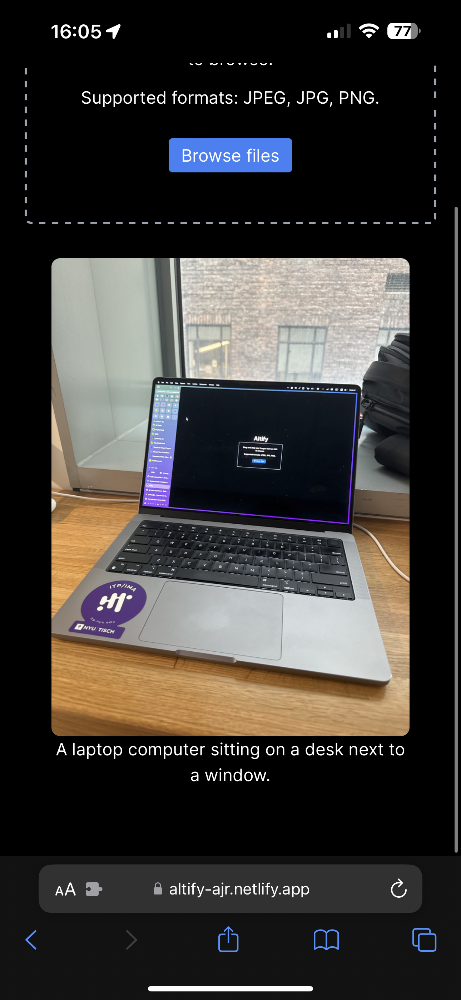
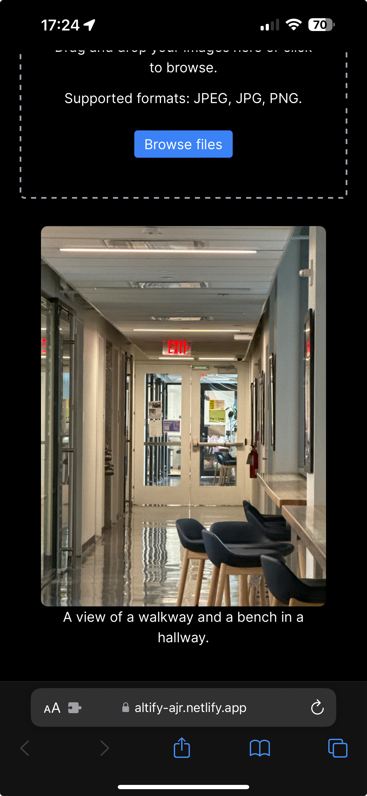

**Altify** is a client-side AI accessibility tool—built as both a standalone Next.js web application ([`altify-ajr.netlify.app`](https://altify-ajr.netlify.app)) and a companion Chrome extension—that generates descriptive `alt` text for unlabelled images directly inside the browser using **Transformers.js** (`@xenova/transformers`) and **DistilViT** (`tarekziade/distilvit` / `Mozilla/distilvit`).

Because all vision-language inference executes locally inside an **ES Module Web Worker** with browser-cached ONNX weights, users with visual impairments can caption local photos or remote web images without uploading private media to third-party cloud APIs or blocking the main UI thread.

---

## System Architecture

### 1. Singleton ONNX Pipeline Inside an ES Module Web Worker (`src/app/worker.js`)

Running a Vision Transformer + GPT-2 decoder on the main browser thread would freeze scrolling, keyboard focus, and screen-reader announcements during tokenization and forward passes. Altify isolates model initialization and inference inside a dedicated module worker (`new Worker(new URL('./worker.js', import.meta.url), { type: 'module' })`) with persistent browser cache storage enabled (`env.useBrowserCache = true`):

```javascript
// src/app/worker.js — Singleton DistilViT image-to-text pipeline in a Web Worker
import { pipeline, env } from '@xenova/transformers';

env.allowLocalModels = false;
env.useBrowserCache = true;

const CORS_PROXY =
  process.env.NEXT_PUBLIC_CORS_FIX_URL ||
  'https://cors-anywhere.herokuapp.com/';

class Image2TextPipeline {
  static instance = null;

  static async getInstance(progress_callback = null) {
    if (!this.instance) {
      this.instance = pipeline('image-to-text', 'tarekziade/distilvit', {
        progress_callback,
      });
    }
    return this.instance;
  }
}

self.addEventListener('message', async (event) => {
  const captioner = await Image2TextPipeline.getInstance((progress) => {
    self.postMessage(progress);
  });

  const targetUrl = event.data.url.startsWith('data:')
    ? event.data.url
    : CORS_PROXY + event.data.url;

  const output = await captioner(targetUrl);
  self.postMessage({ status: 'update', output });
});
```

On the first visit, the worker streams granular shard-download events (`initiate`, `progress`, `done`, `ready`) back to the React UI as the quantized ONNX checkpoints download from Hugging Face Hub into the browser's Cache API. Subsequent visits load the model directly from local cache.

---

### 2. Screen-Reader-First WAI-ARIA Live Region Choreography (`src/app/page.js`)

Because Altify is designed for assistive technology users, the React interface pairs visual progress bars with two distinct **WAI-ARIA live regions** so screen readers (such as macOS/iOS VoiceOver and NVDA) announce both model warm-up and finished descriptions automatically:

- **`aria-live="assertive"` Model Progress Container**: Announces one-time ONNX weight download status (`"Loading models... (only run once)"`) so screen-reader users know why initial inference takes a few seconds on cold start.
- **`aria-live="polite"` Figure Gallery**: Wraps each captioned image in a semantic `role="figure"` container where the `` element's `alt` attribute and linked `<figcaption id="description-${index}">` (`aria-describedby`) transition from `"Loading caption..."` to the generated description (`output.generated_text`), triggering a polite screen-reader readout as soon as the worker posts its `update` message.
- **Dual Input Ingestion (`FileDrop`)**: Accepts both local drag-and-drop / mobile camera Roll uploads (converted to base64 `data:` URLs via `FileReader.readAsDataURL`) and remote image URLs.

<ImageGrid cols={2} caption="Altify running on mobile Safari with VoiceOver-compatible live captioning">
  
  
</ImageGrid>
