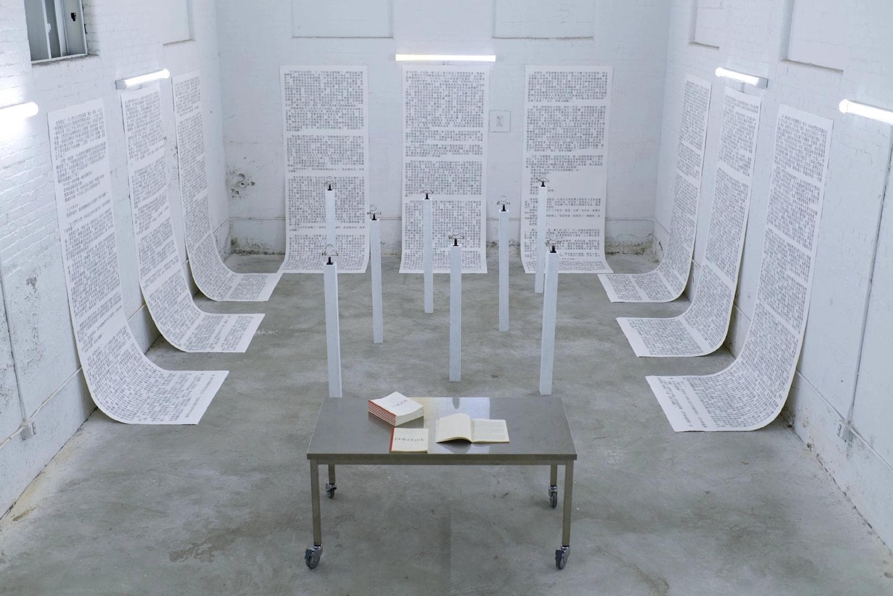
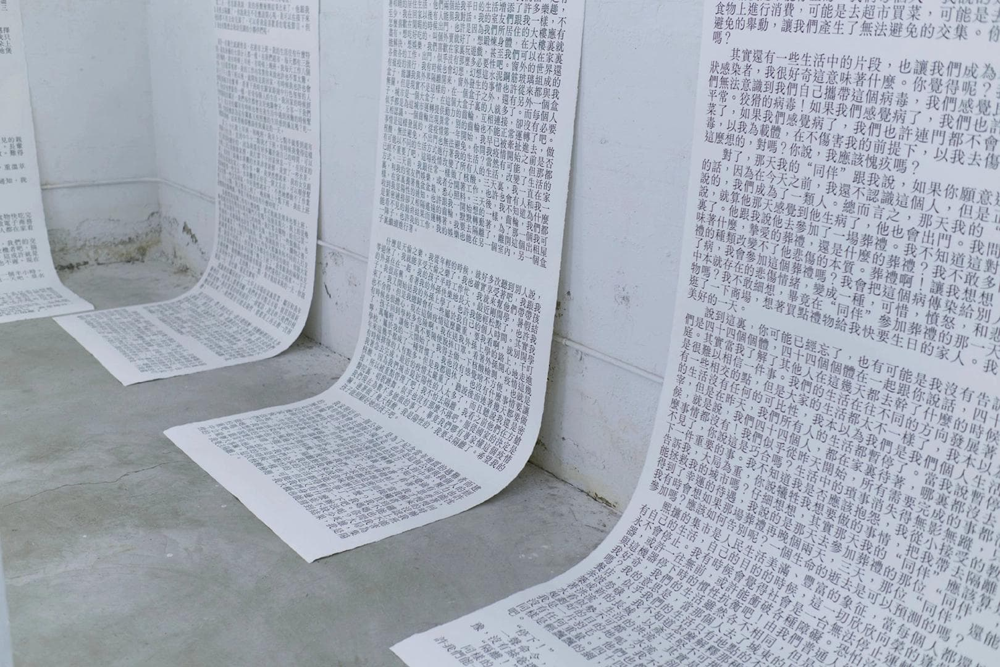
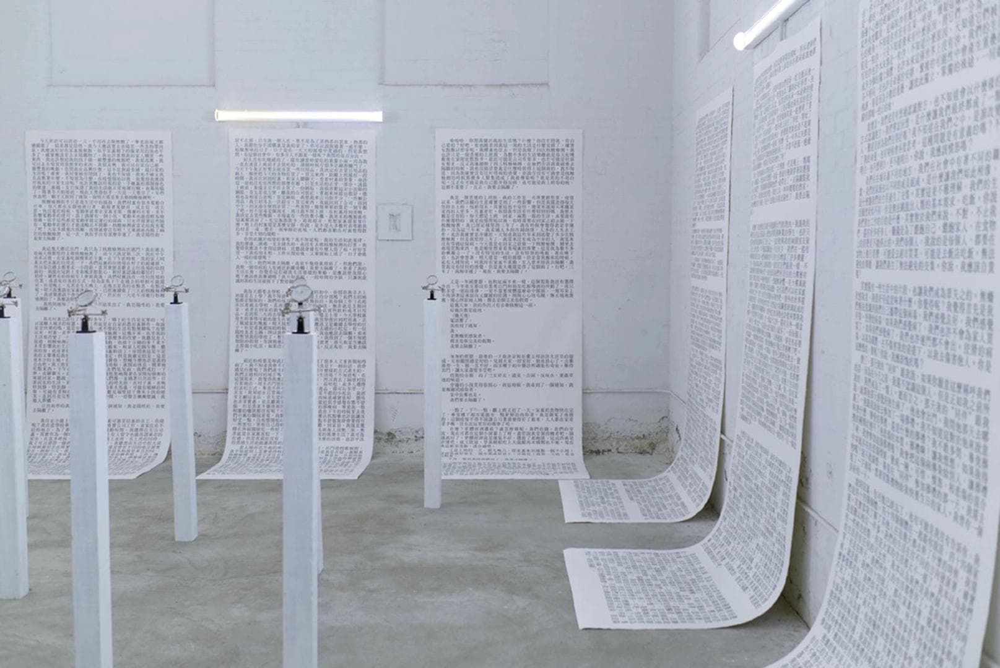
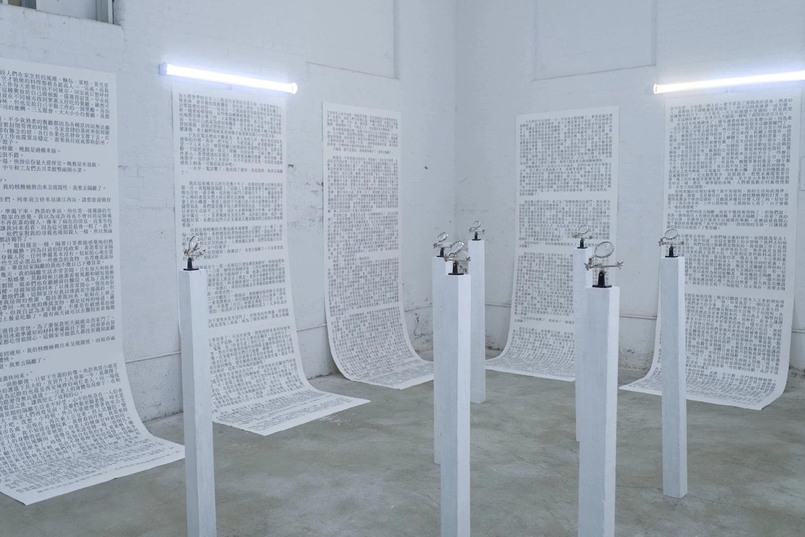
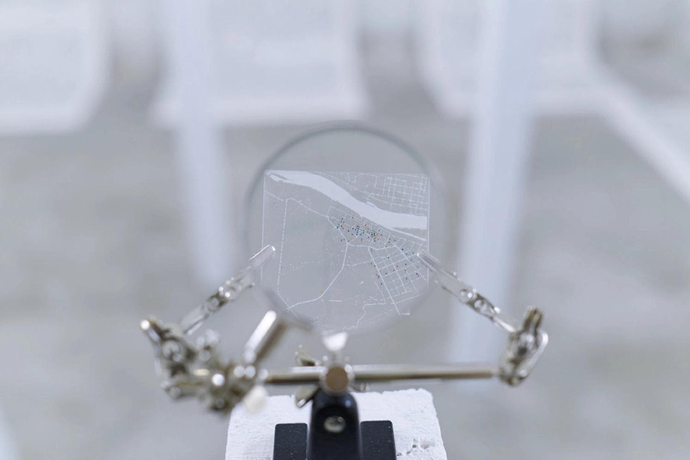
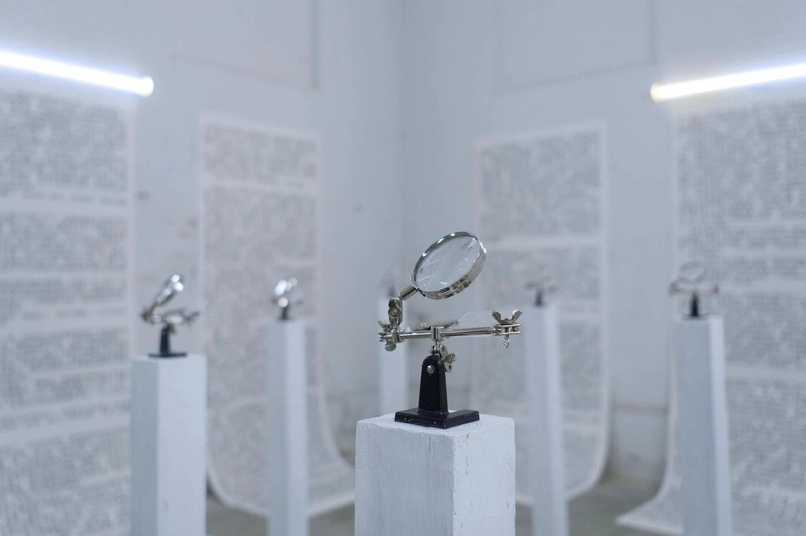
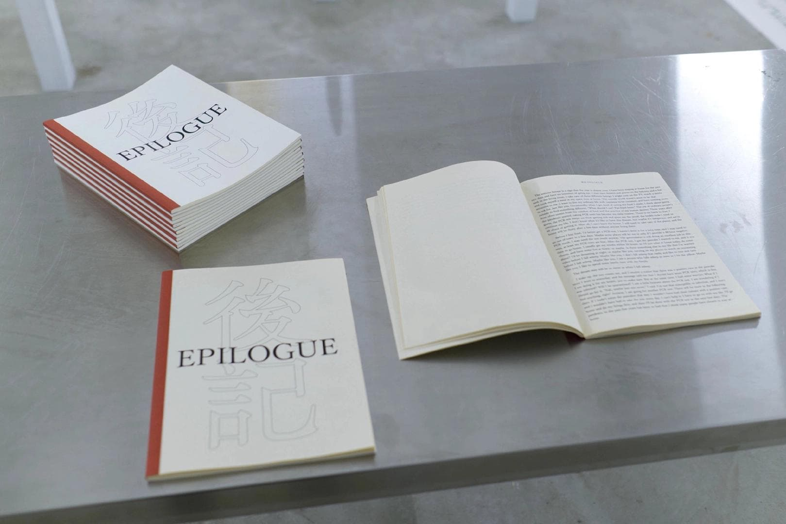
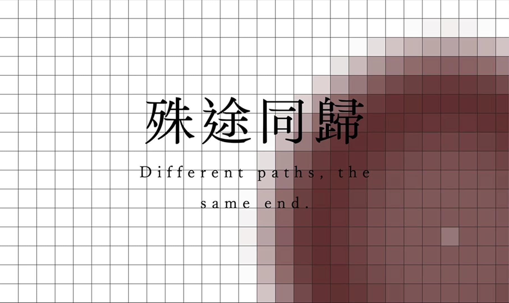
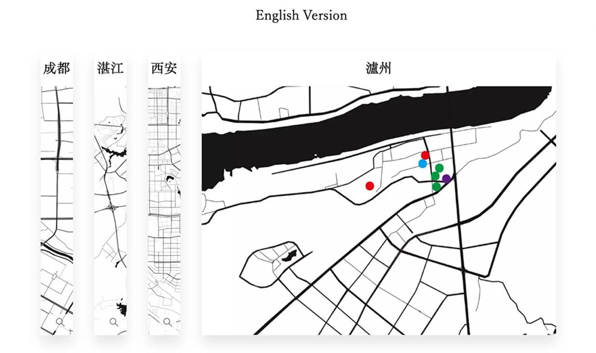
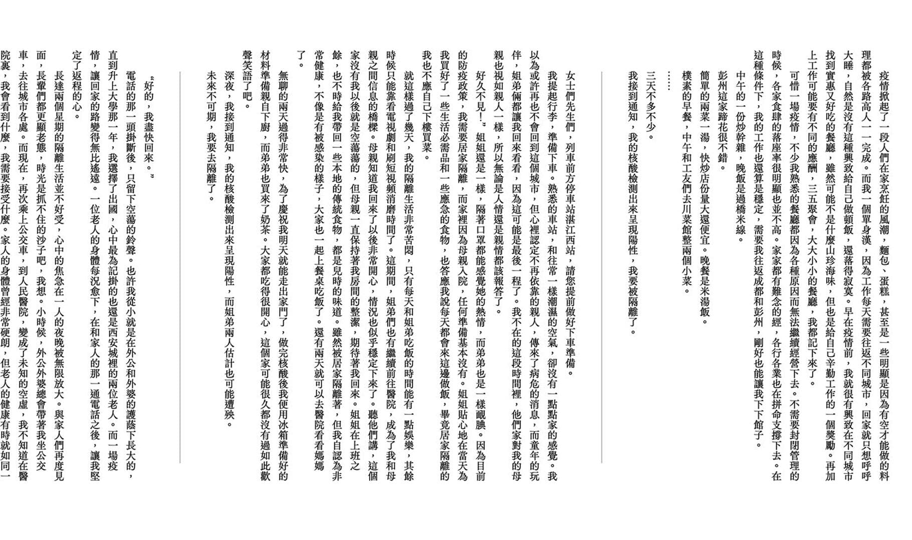

Created in collaboration with **Jixin Zheng** and exhibited at the **80WSE Gallery** (NYU Steinhardt Senior Show, 2023), *Different Paths, The Same End.* is a physical installation, bilingual print publication, and interactive web exhibition ([`paths.katudio.com`](https://paths.katudio.com/)) that examines the human impact of China's zero-COVID policy.

During the policy's enforcement, municipal health authorities routinely published the granular, hour-by-hour travel logs of positive cases in local news outlets—exposing private daily routines (grocery runs, transit transfers, late-night shifts) to public scrutiny before every log converged on the same mandatory outcome: centralized quarantine.

To materialize this tension between institutional surveillance and ordinary life, we researched published epidemiological logs across **eight Chinese cities** and constructed annotated cartographic prints mounted behind suspended **physical magnifying lenses**—inviting gallery visitors to peer into strangers' movements the same way internet bystanders scrutinized published case trajectories. Alongside the maps, we authored and typeset bilingual narratives (Chinese and English) reconstructing the ordinary days that preceded the shared final line: *"I am going to be quarantined."*

---

## Physical Installation & Printed Editions (80WSE Gallery)

<ImageGrid cols={2} caption="Annotated eight-city cartographic installation under suspended magnifying lenses and saddle-stitched bilingual publications at 80WSE Gallery">
  
  
  
  
  
  
  
  
</ImageGrid>

---

## Online Exhibition & Frontend Engineering ([`paths.katudio.com`](https://paths.katudio.com/))

To extend the exhibition beyond the gallery, I designed and engineered the companion web archive ([`paths.katudio.com`](https://paths.katudio.com/)), translating the physical tactile mechanics of the installation into the browser:

- **Interactive Magnifying-Glass Canvas**: Tracks pointer and touch coordinates across each city's vector/high-DPI map to render a real-time optical loupe overlay, revealing fine-print epidemiological timestamps and street-level movement paths on hover.
- **Bilingual Editorial Grid (CJK & Latin)**: Pairs vertical and horizontal Chinese typographic conventions with synchronized English translations across all eight city narratives.

<ImageGrid cols={2} caption="Interactive web archive at paths.katudio.com featuring real-time cursor magnifying loupe and bilingual narrative typography">
  
  
  
  
</ImageGrid>
