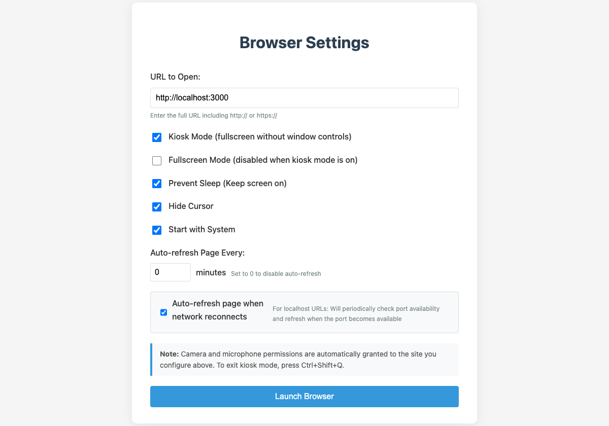
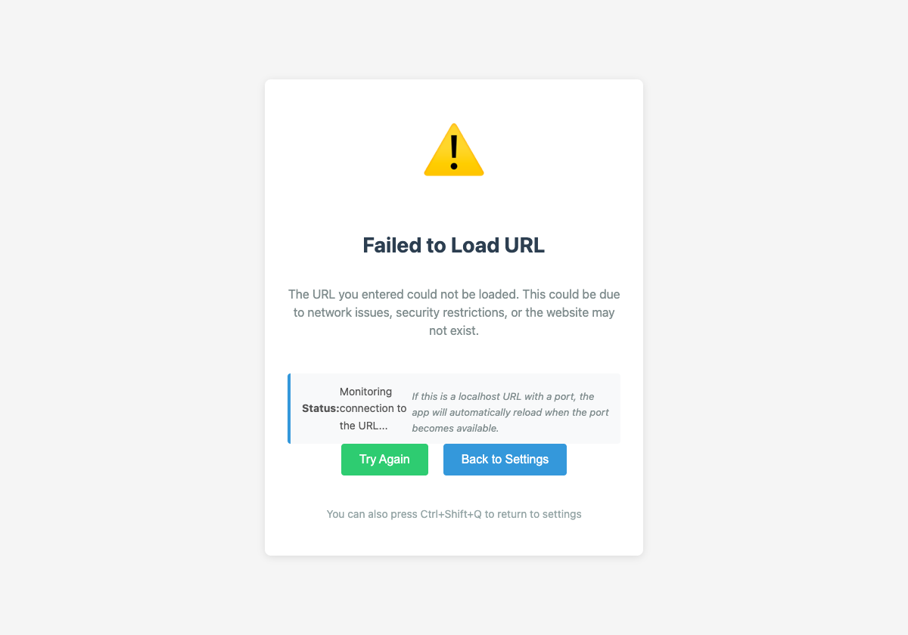

**Jumpstart** is an open-source, cross-platform Electron kiosk wrapper designed to turn any web-based creative coding sketch (`p5.js`, `ml5.js`, `Three.js`, `WebGPU`, or a local Node/Python server) into a resilient, self-healing exhibition appliance on **macOS, Windows, Linux (`x64`/`arm64`), and 64-bit Raspberry Pi OS**.

Presented at **COSA × NYU: *Machine Learning Tools for Creative Coding*** (March 2025), Jumpstart grew out of a recurring pain point in physical computing shows and gallery installations: browser-based sketches frequently break on unattended boot because a Chromium camera permission dialog steals focus, the OS blanks the display, or the browser launches two seconds before a local `localhost` server finishes binding its port.

<ImageGrid cols={2} caption="Jumpstart operator configuration interface (left) and automatic localhost/network recovery monitor (right)">
  
  
</ImageGrid>

---

## Core Engineering Architecture

### 1. Origin-Scoped Camera & Microphone Auto-Grant (+ Linux PipeWire)

Interactive vision and audio installations built with [[ml5-research|ml5.js]] or WebRTC fail in unattended kiosk mode if the browser pauses to ask *"Allow site to use your camera and microphone?"*—especially on headless Raspberry Pi or projector setups without a mouse attached.

Rather than disabling web security globally, Jumpstart implements **origin-scoped permission handlers** (`setPermissionRequestHandler` and `setPermissionCheckHandler`) that automatically approve `camera`, `microphone`, and `media` requests strictly for the operator-configured `trustedOrigin` while rejecting cross-origin iframe escalation:

```javascript
// src/main.js — Origin-scoped media permission auto-grant + Linux PipeWire flags
const MEDIA_PERMISSIONS = new Set(['media', 'camera', 'microphone']);

function setupLinuxCameraPermissions() {
  if (process.platform !== 'linux') return;
  app.commandLine.appendSwitch('enable-features', 'WebRTCPipeWireCapturer');
}

const isTrustedMedia = (permission, requestingUrl) => {
  if (!MEDIA_PERMISSIONS.has(permission)) return false;
  const requestingOrigin = getOriginFromUrl(requestingUrl);
  return Boolean(trustedOrigin && requestingOrigin === trustedOrigin);
};

contentSession.setPermissionRequestHandler((webContents, permission, callback, details) => {
  const requestingUrl =
    (details && (details.requestingUrl || details.embeddingOrigin)) || webContents.getURL();
  callback(isTrustedMedia(permission, requestingUrl));
});
```

On Linux and Raspberry Pi OS (Bookworm/Wayland), Jumpstart also appends `--enable-features=WebRTCPipeWireCapturer` prior to `app.whenReady()` and injects `Permissions-Policy: camera=(self), microphone=(self)` headers on responses from the trusted origin so `navigator.mediaDevices.getUserMedia()` works out of the box.

---

### 2. Self-Healing Localhost TCP Probe & Network Reconnection (`monitorNetworkStatus`)

In many exhibition setups, the visual frontend connects to a local Python, TouchDesigner, or Node.js server (`http://localhost:3000` or `http://127.0.0.1:8000`) that takes several seconds to initialize after the machine boots.

If the initial load fails—or if the renderer process crashes (`render-process-gone`)—Jumpstart transitions to a local diagnostic screen (`error.html`) and starts a 5-second health monitor tailored to the target URL type:

- **Localhost Targets (`localhost`, `127.0.0.1`, `::1`)**: Opens a raw `net.Socket()` TCP connection probe against the target port (`1000ms` timeout). As soon as the local server binds its port, Jumpstart waits `2000ms` for service warm-up and calls `window.loadURL(targetUrl)` to transition directly into the live installation.
- **Remote HTTPS/HTTP Targets**: Dispatches lightweight `HEAD` requests (`5000ms` timeout) and automatically reloads the exhibition URL `3000ms` after Wi-Fi or Ethernet connectivity returns.

```javascript
// src/main.js — Raw TCP socket port polling for localhost creative coding servers
const checkLocalPort = (port) => {
  return new Promise((resolve) => {
    const socket = new net.Socket();
    const timeout = setTimeout(() => {
      socket.destroy();
      resolve(false);
    }, 1000);

    socket.connect(port, '127.0.0.1', () => {
      clearTimeout(timeout);
      socket.destroy();
      resolve(true);
    });

    socket.on('error', () => {
      clearTimeout(timeout);
      socket.destroy();
      resolve(false);
    });
  });
};
```

---

### 3. Native Cross-Platform Autostart & Display Sleep Inhibition

To ensure an installation recovers automatically after a gallery power cycle without manual intervention across heterogeneous hardware:

| Platform | Autostart Mechanism (`configureAutoStart`) | Display Sleep & Cursor Control |
| :--- | :--- | :--- |
| **macOS** (`.dmg` / `.zip`) | Generates `~/Library/LaunchAgents/com.Jumpstart.plist` (`RunAtLoad`) + `launchctl load` | `powerSaveBlocker.start('prevent-display-sleep')` + `dom-ready` CSS `cursor: none !important` |
| **Windows** (`NSIS` / `Portable .exe`) | Resolves `PORTABLE_EXECUTABLE_FILE` and writes a Startup `.lnk` shortcut via PowerShell `WScript.Shell` | `powerSaveBlocker` + global `Ctrl+Shift+Q` kiosk escape shortcut |
| **Linux & Raspberry Pi (`x64` / `arm64`)** | Resolves `APPIMAGE` or binary path and writes `~/.config/autostart/Jumpstart.desktop` (`X-GNOME-Autostart-enabled=true`) | `powerSaveBlocker` + X11 DPMS fallback (`xset s off -dpms`) |

---

### 4. Privilege Separation Between Operator Settings & Remote Content

Because Jumpstart can load arbitrary remote URLs in its kiosk window, the Electron architecture enforces strict privilege separation between the local operator settings window (`mainWindow`) and the kiosk browser window (`browserWindow`):

- **Settings Window (`preload.js`)**: Runs with `contextIsolation: true`, `nodeIntegration: false`, and `sandbox: true`, exposing `saveSettings` and `loadSettings` over IPC.
- **Kiosk Content Window (`preload-content.js`)**: Uses a minimal preload script that strips settings and OS-autostart APIs, blocks `window.open` popups (`setWindowOpenHandler(() => ({ action: 'deny' }))`), restricts navigation to `http:` and `https:` protocols, and verifies `event.sender === mainWindow.webContents` inside `ipcMain.on('save-settings')` as defense in depth.
