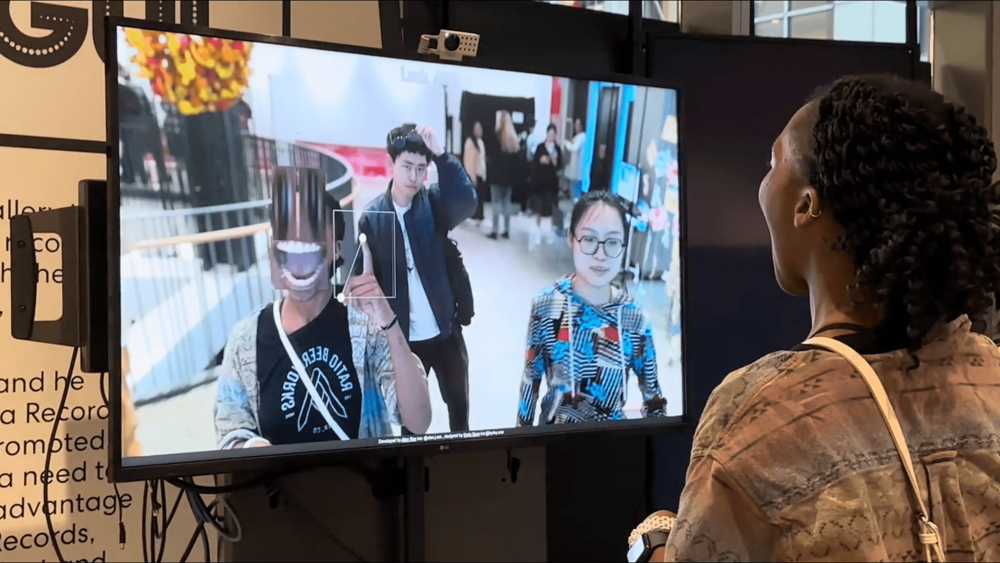

*Look At You!!!* is a life-sized interactive mirror installation created in collaboration with [Kyrie Yang](https://www.instagram.com/kyriey.ooo/) and exhibited at the **2024 NYU ITP/IMA Spring Show**. Inspired by the everyday ritual of checking a mirror before heading to work, class, or social gatherings, the installation uses real-time computer vision to turn a passing glance into a moment of playfulness and genuine laughter.

---

## Multi-Model Computer Vision & Hardware Setup

To support groups of visitors stepping in front of the mirror simultaneously without frame drops, the application was engineered with **Vite, vanilla JavaScript, p5.js, and [[ml5-research|ml5.js]]**:

- **Concurrent Multi-Person Tracking**: Runs two machine learning models simultaneously on the client GPU—**`ml5.handPose()`** (configured to track up to **20 hands**) and **`ml5.faceMesh()`** (configured to track up to **10 faces**)—allowing multiple visitors to pinch, stretch, and playfully distort their facial features in real time.
- **Physical Exhibition Hardware**: Driven by a **Mac mini** paired with a **4K wide-angle webcam** and a vertically mounted **70-inch display**, producing 1:1 life-sized dynamic reflections at building entrances and high-traffic corridors.

---

## Documentation — NYU ITP/IMA Spring Show 2024

- **Video Documentation**: [Watch the 7-part visitor interaction playlist on YouTube](https://www.youtube.com/playlist?list=PL-5cggvKHQvd5XJXZsCZl6QIexVz6kOgF)

