Selected for the **2024 NYU Tandon Research Excellence Exhibit**, *The Theater* is an interactive VR theatre piece built in **Unreal Engine 5** that blends traditional Chinese opera aesthetics with contemporary mechanical design—combining live dance choreography, optical and AI motion capture, and controller-free hand tracking to explore the tension between **collectivism** and **individualism**.

The experience places the audience inside two contrasting virtual stages—one embodying Eastern collectivism and the other Western individualism. Rather than passively watching a pre-recorded 360° film, participants inhabit a living theatrical stage where their physical hand gestures and spatial movement directly trigger scene transitions, lighting cues, and choreographed responses from the virtual performers.

---

## Engineering Role & VR Interaction Systems

As **VR Game Developer** alongside co-director John Luo, my engineering work focused on bridging the high-fidelity Unreal Engine 5 cinematic assets with real-time headset performance and embodied interaction:

1. **Controller-Free Hand Tracking & Gesture Triggers**: Integrated OpenXR/Meta Quest skeletal hand tracking into Unreal Engine 5 so audience members can interact with stage props, summon theatrical masks, and drive narrative branching naturally with bare hands—removing the barrier of unfamiliar VR game controllers for gallery visitors.
2. **Dual-World Stage State Machine**: Engineered the interactive scene management and real-time level streaming transitions between the Eastern collectivist stage and Western individualist stage, synchronizing spatial audio stems with motion-captured character animation sequences.
3. **Real-Time Skeletal Retargeting & Cloth Integration**: Integrated multi-performer OptiTrack and AI motion-capture (`Qian Mian`) animation takes onto custom mechanical character rigs running **UE5 Chaos Cloth** garment simulations.

---

## Shan Gui — 3D Short Film & Visual World

The accompanying 3D short film, *Shan Gui*, serves as the visual and thematic prologue for the VR experience. Reimagining the Mountain Spirit from Qu Yuan's classical poem (*Nine Songs*) as an androgynous mechanical figure in Unreal Engine 5, the film establishes the project's core themes of isolation, longing, and cultural memory.

<ImageGrid cols={2} caption="Stills from Shan Gui and the interactive VR stages, rendered in Unreal Engine 5">
  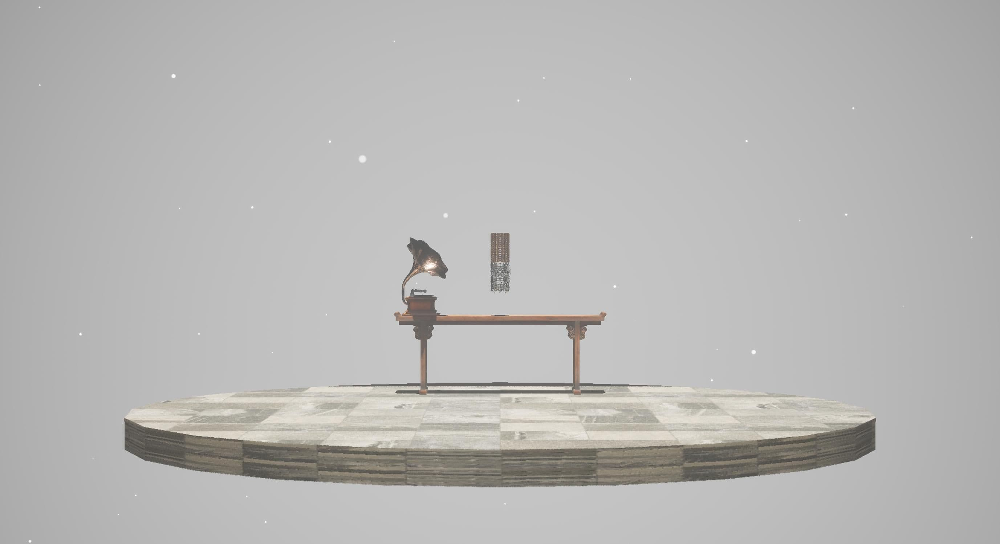
  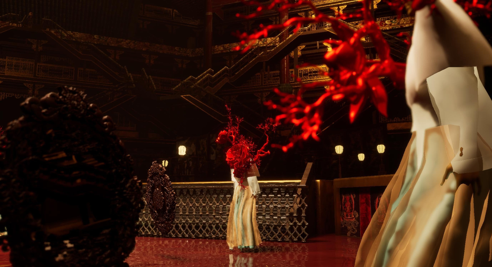
  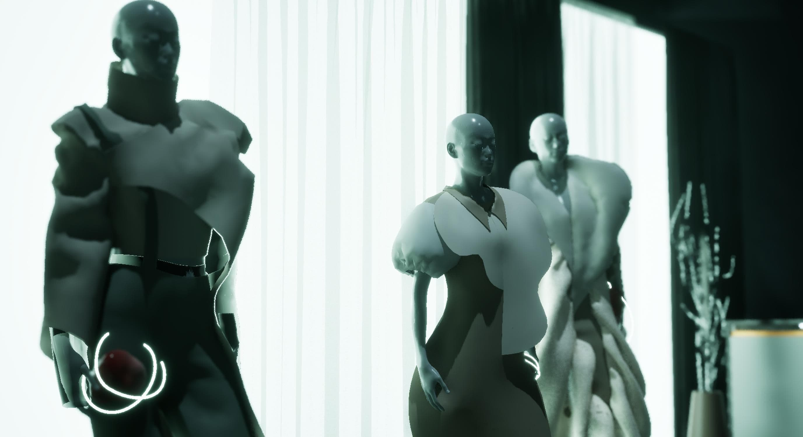
  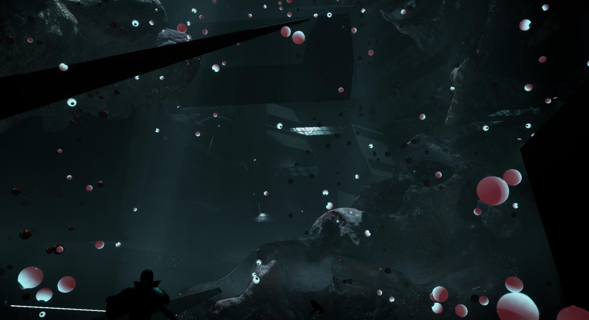
  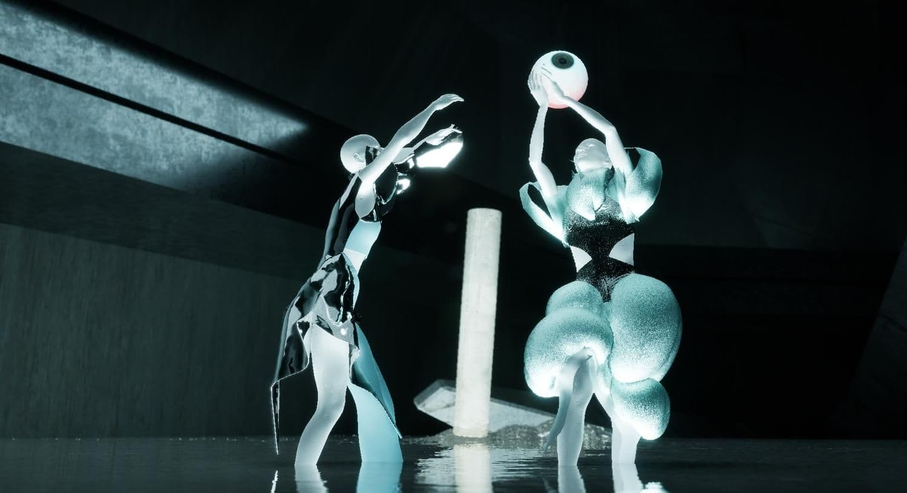
  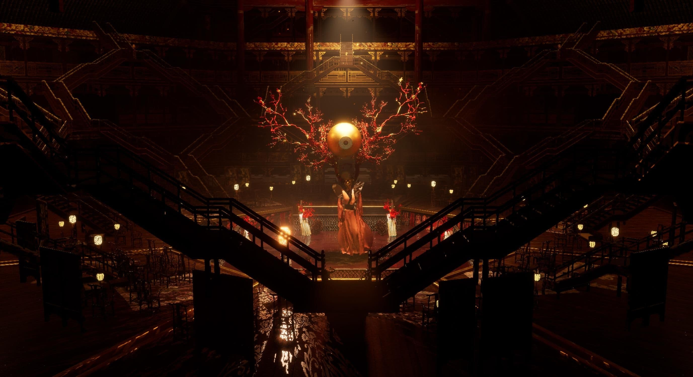
  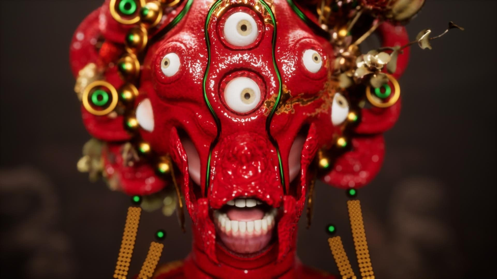
  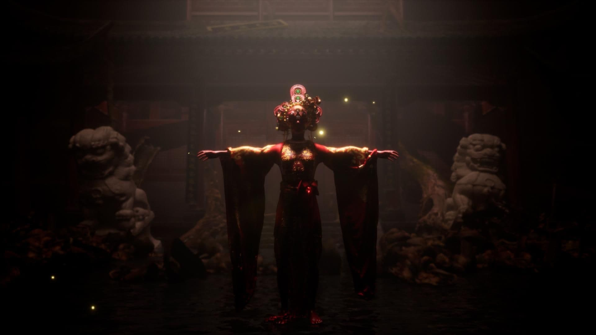
</ImageGrid>

## Motion Capture & Interactive Choreography

Performances combine AI motion capture (`Qian Mian`) with multi-camera **OptiTrack** optical volumes to record professional dancers. AI mocap enabled performers to rehearse and iterate in unconstrained studio spaces, while OptiTrack captured sub-millimeter multi-performer interactions for real-time VR staging.

<ImageGrid cols={3} caption="OptiTrack motion capture sessions and real-time Unreal Engine 5 skeletal retargeting">
  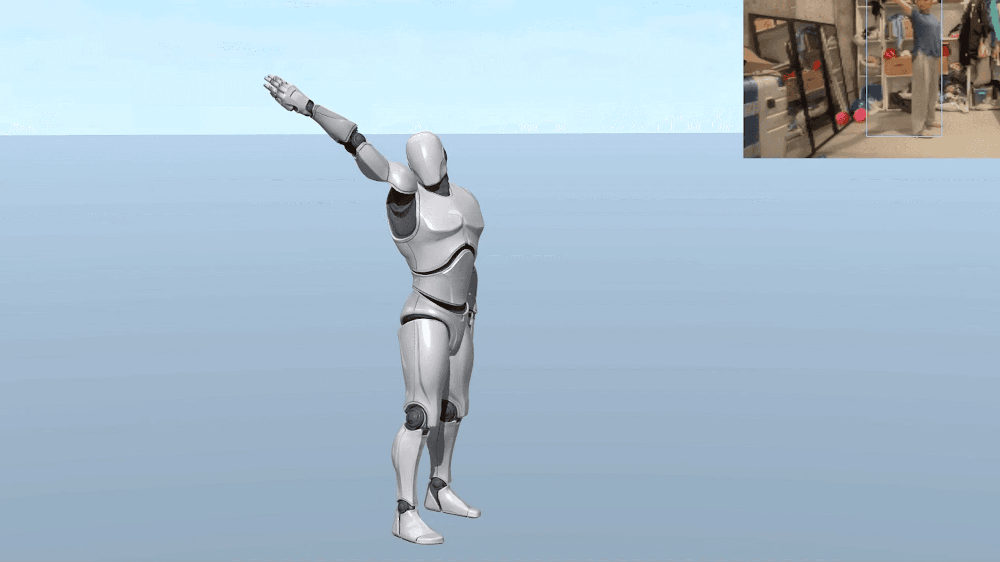
  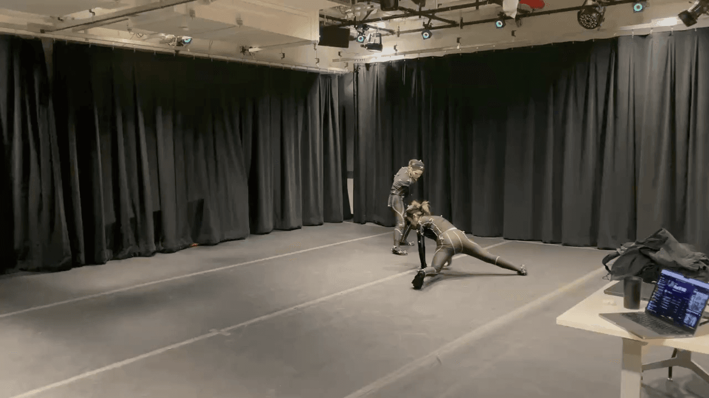
  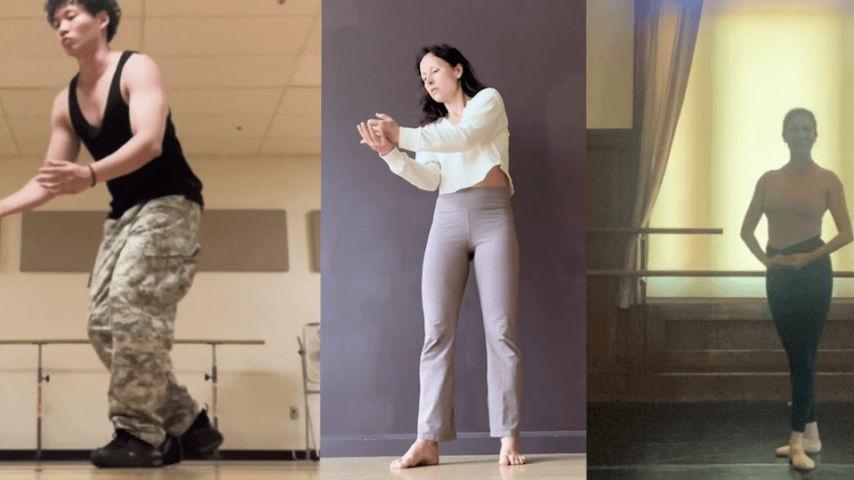
</ImageGrid>

## Digital Fashion & Chaos Cloth Simulation

Costumes were patterned in **Marvelous Designer** and simulated in real time using Unreal Engine 5's **Chaos Cloth** solver, paired with AI-assisted 3D ornamental modeling to preserve the flowing sleeves, weight, and silhouette of traditional Chinese opera garments inside VR.

<ImageGrid cols={2} caption="Garment simulation and character ornamentation in Unreal Engine 5">
  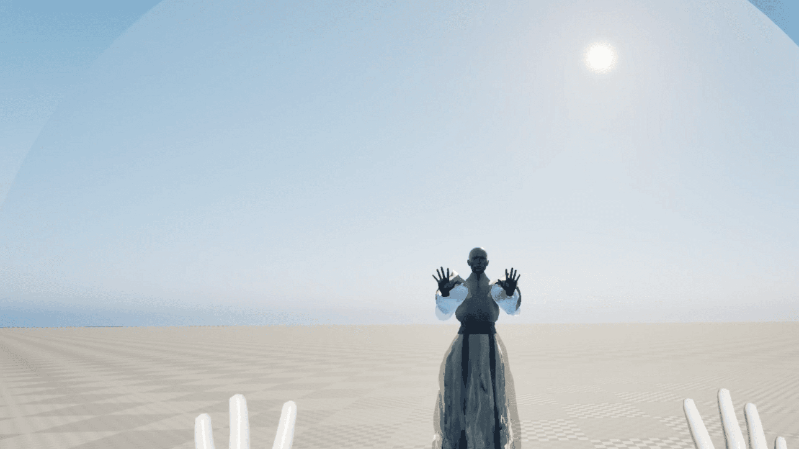
  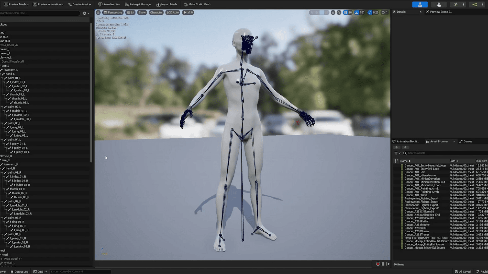
  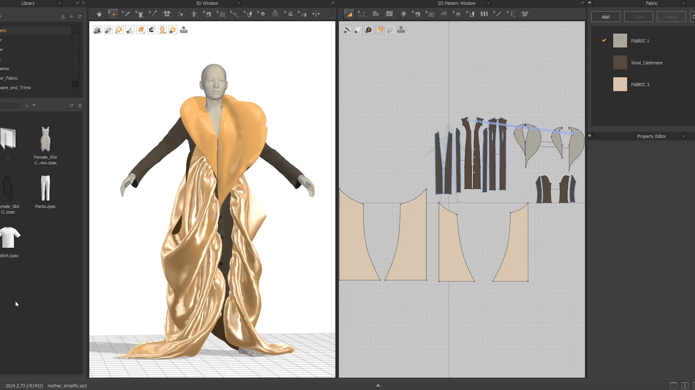
  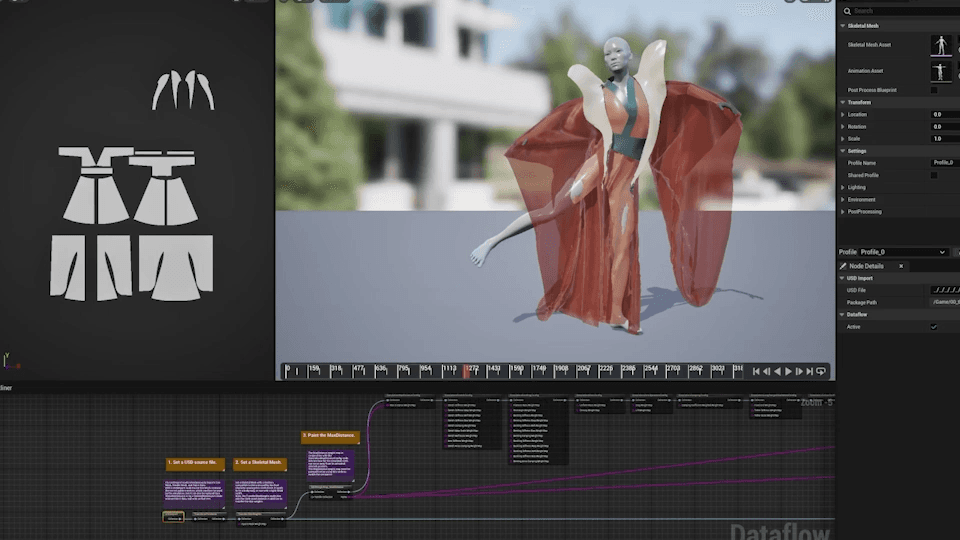
</ImageGrid>

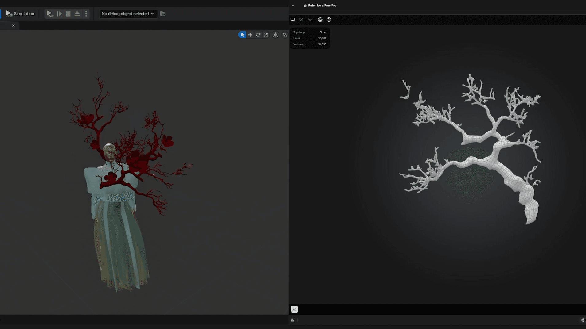

## Credits

- **Co-Directors**: John Luo, Yingru Huang
- **Choreography Director**: Yingru Huang
- **Screenplay Co-Director**: Lois He
- **Game Developers**: John Luo, Alan Ren (Alan Yam)
- **Tech & 3D Artists**: John Luo, Kano Tao, Yi Wang
- **Fashion Designers**: Maggie Zhou, Yoyo Shang
- **Fashion Consultants**: Elena Liu, Annie Xing, Laurel Fang
- **Music Composers**: Yingru Huang, Alexia Diaz, Chienn Tai
- **Hand Tracking Template**: Jason Meisel
- **Motion Capture Performers**: Yingru Huang, Tanya Xu, Wisdom Zhang, Audrey Chou, Chienn Tai, Siyu Duan, Karin K. Jensen, Kylie Boyd, Kamala Fifield, Addy Bradley, Kai Hannigan
