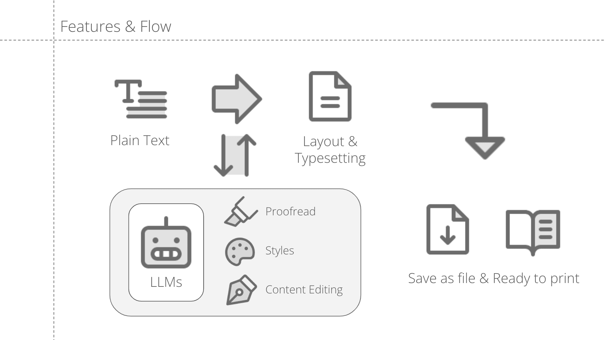
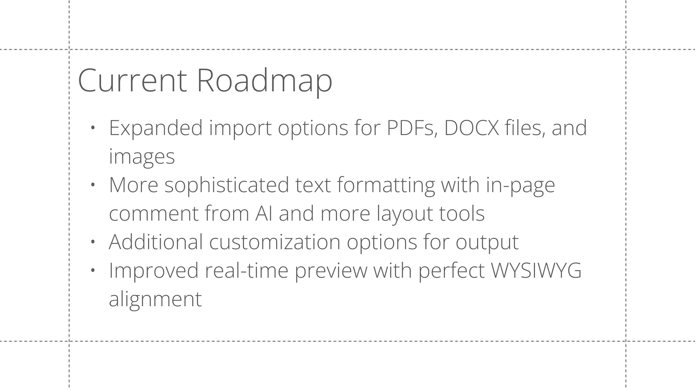

**Typer** is a browser-based typesetting and page-layout editor for graphic designers—built to handle multi-page publications (zines, booklets, portfolios), structured one-pagers, and print-ready PDF output without the steep learning curve or licensing overhead of legacy desktop publishing suites.

Unlike standard rich-text editors that treat a document as an infinite vertical scroll, Typer renders **true physical page boxes** directly in the DOM and exports via the browser's print engine and `pdf-lib`—maintaining **one render tree and one geometry source** so what you compose on screen is pixel-identical to what prints.

---

## System Architecture & Editor Engine

Modernized on **Next.js 16, React 19, Tiptap 3 (ProseMirror), Dexie, and Vercel AI SDK 7**, the editor combines deterministic print geometry with layout-aware LLM assistance:

1. **Single-Geometry Page-Box Rendering (`Tiptap 3` + Print Engine)**: Custom ProseMirror/Tiptap node extensions (`@tiptap/react`, `@tiptap/pm`) partition document content into discrete physical trim sizes, margins, running headers/footers, and multi-column grids. Because screen preview and PDF export share the exact same DOM geometry tree, there is zero pagination drift between editing and final print output.
2. **Layout-Aware AI Copyfitting (`Vercel AI SDK 7` + `Google Gemini`)**: Integrates `@ai-sdk/google` (`Gemini 2.5 Flash`) with custom spatial constraints so the AI assistant can rewrite, condense, or hierarchy-normalize copy to fit exact line counts, column depths, and typographic scales without overflowing a page box.
3. **Local-First IndexedDB Persistence (`Dexie` + `@pdf-lib/fontkit`)**: Documents, custom typographic presets, and embedded OpenType/TrueType font metrics are persisted client-side in **IndexedDB via Dexie** (`dexie-react-hooks`), allowing instant offline-capable editing and zero-latency layout recomputation.

---

## User Research & Product Direction

Through in-depth interviews with graphic and editorial designers transitioning from studio coursework to commercial practice, three structural findings shaped Typer's design:

- **Non-Linear Revision Overhead**: Even single-sheet poster layouts require 5–6 hours of iteration, while multi-chapter booklets span weeks of manual style synchronization—with late-stage copy edits forcing cascading manual reflows across pages.
- **Tool Fragmentation**: While senior publication designers rely on rigid InDesign scripts, early-career designers frequently chain multiple tools (Figma, Google Docs, Markdown editors, and PDF utilities) to bridge technical gaps, introducing formatting drift between drafts.
- **Browser-Native Accessibility**: Independent designers strongly favor lightweight, zero-install browser tooling with local document ownership over heavyweight enterprise subscriptions.

## Product Roadmap

