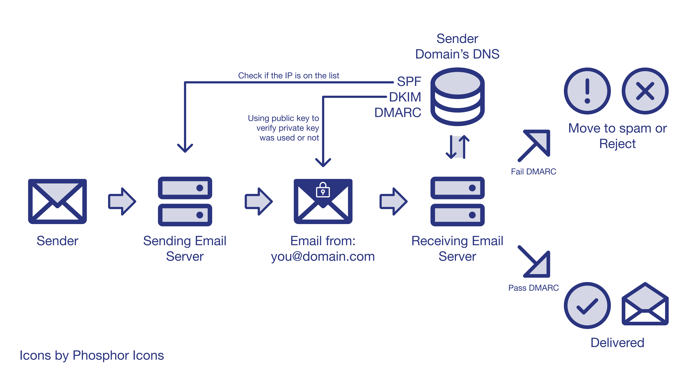
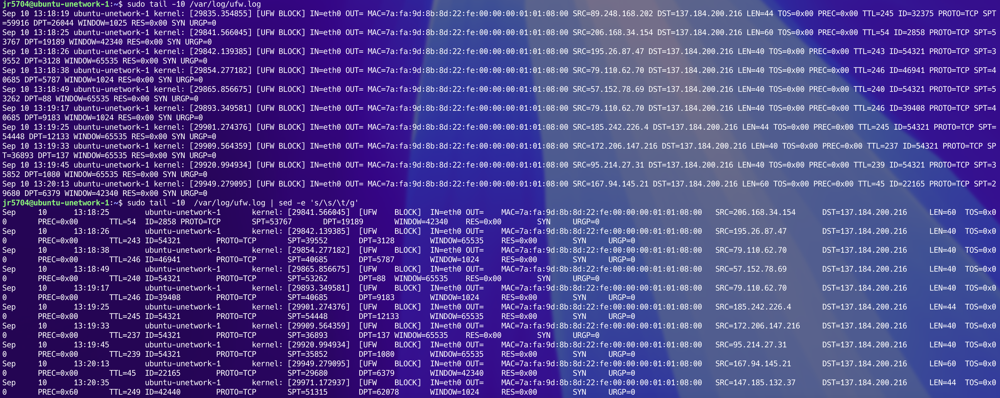
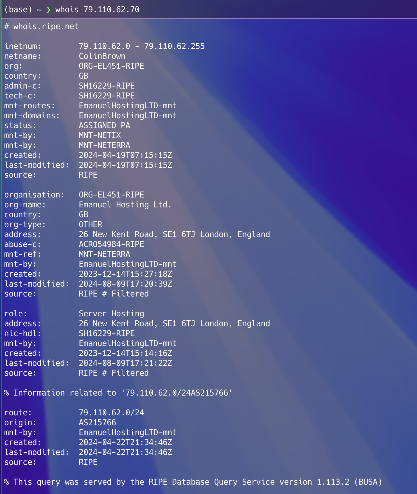
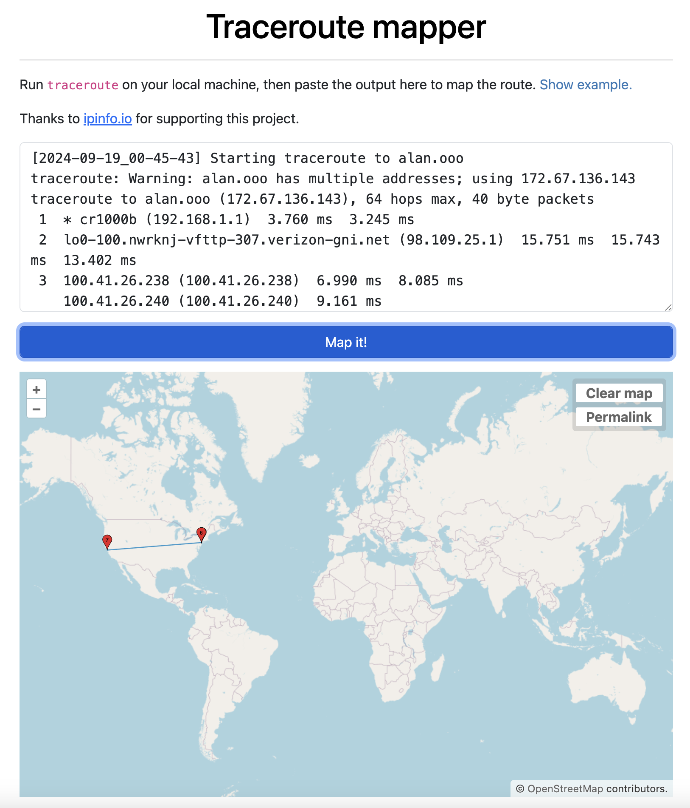
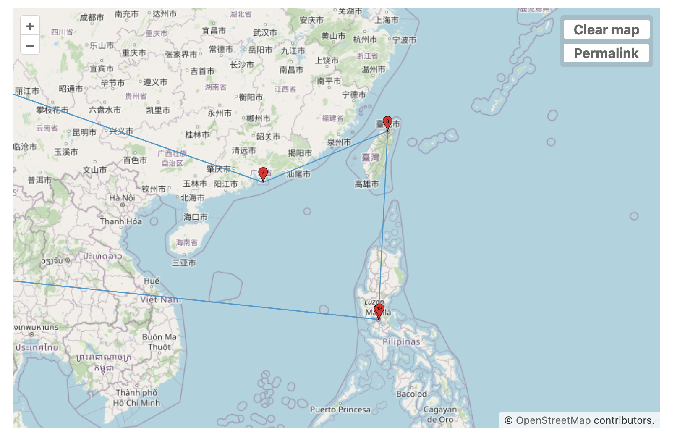
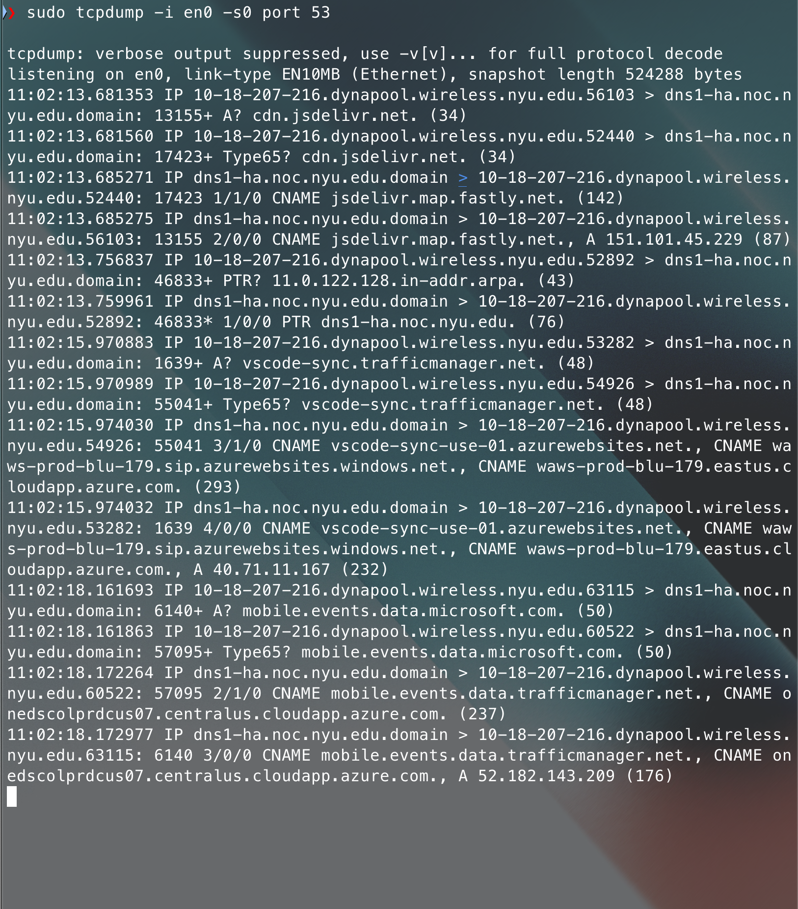
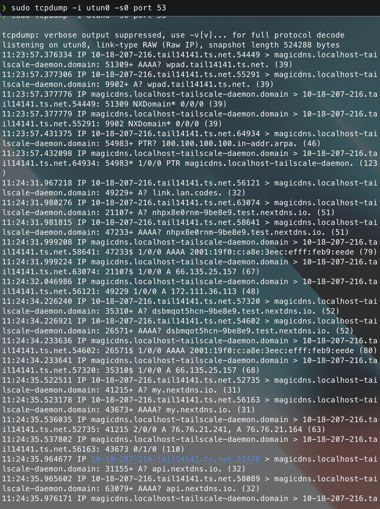

Developed across Tom Igoe's **Understanding Networks** course at NYU ITP (Fall 2024), this project series investigates how trust, state, and physical interaction move across network layers—from **DNS-backed cryptographic email authentication (SPF, DKIM, and DMARC)** to **real-time UDP/OSC and WebSocket-to-TCP protocol bridges** for multiplayer games, **autonomous system routing topology**, and **packet-level firewall and DNS forensics**.

---

## 1. Email Authentication Architecture: SPF, DKIM & DMARC

Core **SMTP (`RFC 5321`)** was designed without built-in sender verification. During an SMTP handshake, a mail transfer agent (MTA) declares two distinct sender identities that recipients rarely see side by side:

1. **The Envelope Sender (`RFC 5321.MailFrom` / `Return-Path`)**: Announced during the `MAIL FROM:<bounce@server.example.com>` SMTP command and used by mail servers for bounce handling.
2. **The Header From (`RFC 5322.From` / "Friendly-From")**: Embedded inside the message data payload (`From: "Alan" <you@domain.com>`) and displayed directly to the human recipient in their mail client.

Because raw SMTP allows any host on the internet to open port `25` and supply an arbitrary `From:` header, modern email security layers three DNS-published mechanisms—**SPF**, **DKIM**, and **DMARC**—to verify **where** a message originated, prove **cryptographic integrity** in transit, and enforce **domain alignment**.

, DKIM (cryptographic signature verification), and DMARC (Friendly-From alignment and policy enforcement)")

### Layer 1: SPF (Sender Policy Framework — `RFC 7208`)

**SPF** authenticates the **connecting IP address** of the sending email server against a list of authorized senders published in the domain's DNS `TXT` record:

```dns
; DNS TXT record at domain.com
domain.com.  3600  IN  TXT  "v=spf1 ip4:198.51.100.24 include:_spf.google.com ~all"
```

When a receiving MTA accepts a connection from a sending server IP, it extracts the domain from the SMTP `MAIL FROM` (Return-Path) address, queries that domain's SPF `TXT` record, and evaluates whether the connecting IP matches an authorized `ip4`, `ip6`, `a`, `mx`, or `include` mechanism.

- **What SPF solves**: Prevents unauthorized servers from sending mail claiming an envelope `Return-Path` on your domain.
- **Why SPF alone is insufficient**:
  1. **The Friendly-From Gap**: SPF only validates the hidden `RFC 5321.MailFrom` envelope domain—not the `RFC 5322.From` header shown in the user's inbox. An attacker can pass SPF using their own envelope domain (`MAIL FROM:<attacker@evil.example>`) while still spoofing `From: ceo@domain.com` in the message body.
  2. **Forwarding Fragility**: If an intermediary server forwards an email without rewriting the `Return-Path` (via SRS), the receiving MTA sees the forwarder's IP instead of the original sender's IP, causing SPF to fail.

### Layer 2: DKIM (DomainKeys Identified Mail — `RFC 6376`)

**DKIM** solves forwarding fragility and in-transit tampering by attaching a **cryptographic digital signature** directly to the email header.

1. **Signing (Outbound MTA)**: Before transmitting the message, the sending server hashes specified headers (such as `From`, `To`, `Subject`, `Date`) and the canonicalized message body, then signs that hash with a private RSA or Ed25519 key. It injects a `DKIM-Signature` header into the email:

   ```http
   DKIM-Signature: v=1; a=rsa-sha256; c=relaxed/relaxed;
     d=domain.com; s=2024a;
     h=from:to:subject:date:message-id;
     bh=47DEQpj8HBSa+/TImW+5JCeuQeRkm5NMpJWZG3hSuFU=;
     b=MIIBIjANBgkqhkiG9w0BAQEFAAOCAQ8A...
   ```

2. **Verification (Inbound MTA)**: The receiving server reads the signing domain (`d=domain.com`) and selector (`s=2024a`), queries the DNS `TXT` record at `2024a._domainkey.domain.com` to retrieve the public key (`p=...`), and verifies that the signature matches the message headers and body hash:

   ```dns
   ; DNS TXT record at 2024a._domainkey.domain.com
   2024a._domainkey.domain.com.  3600  IN  TXT  "v=DKIM1; k=rsa; p=MIIBIjANBgkqhkiG9w0BAQEFAAOCAQ8AMIIBCgKCAQEA..."
   ```

Because the signature travels inside the message header rather than depending on the hop-by-hop connecting IP, a valid DKIM signature survives standard email forwarding as long as intermediate relays do not mutate the signed headers or body.

### Layer 3: DMARC (Identifier Alignment & Policy — `RFC 7489`)

While SPF verifies the connecting IP and DKIM verifies a cryptographic signature, neither protocol by itself requires its authenticated domain to match the **`RFC 5322.From` ("Friendly-From")** domain displayed to the end user. **DMARC** bridges that gap through **Identifier Alignment** and policy enforcement:

```dns
; DNS TXT record at _dmarc.domain.com
_dmarc.domain.com.  3600  IN  TXT  "v=DMARC1; p=quarantine; sp=reject; adkim=s; aspf=r; rua=mailto:dmarc-reports@domain.com"
```



For an email to **pass DMARC**, at least one of the following alignment checks must succeed:

- **SPF Alignment (`aspf`)**: SPF must pass **AND** the authenticated `RFC 5321.MailFrom` domain must match the visible `RFC 5322.From` domain (exact match in strict mode `aspf=s`, or organizational root domain match in relaxed mode `aspf=r`).
- **DKIM Alignment (`adkim`)**: DKIM signature verification must pass **AND** the signing domain (`d=`) in the `DKIM-Signature` header must match the visible `RFC 5322.From` domain.

| Protocol | Authenticated Identity | DNS Record Location | Cryptographic Mechanism | Survives Forwarding? |
| :--- | :--- | :--- | :--- | :--- |
| **SPF** | Connecting MTA IP + `RFC 5321.MailFrom` (Return-Path) | `domain.com` (`TXT`) | None (IP / CIDR / hostname lookup) | No (breaks unless forwarder rewrites envelope via SRS) |
| **DKIM** | Signing domain (`d=`) in `DKIM-Signature` header | `<selector>._domainkey.domain.com` (`TXT`) | RSA / Ed25519 asymmetric signature over headers & body hash | Yes (if signed headers and body remain unmodified) |
| **DMARC** | Visible `RFC 5322.From` ("Friendly-From") header | `_dmarc.domain.com` (`TXT`) | Enforces alignment (`aspf` / `adkim`) + disposition (`p=none\|quarantine\|reject`) | Yes (via aligned DKIM signature) |

If both SPF alignment and DKIM alignment fail, the receiving server executes the domain owner's published DMARC policy (`p=quarantine` moves the message to spam; `p=reject` drops the message at the SMTP gateway) and dispatches aggregate XML telemetry (`rua`) back to the domain administrator.

---

## 2. Real-Time Protocol Bridges for Multiplayer TCP (`BallDropServer`)

In the second half of the course, we built networked controllers for Tom Igoe's multiplayer Pong-style game **`BallDropServer`**. The game server listens on a raw **TCP socket (`port 8080`)** and expects newline-terminated ASCII commands (`n=Alan\n` to set the player name, `w`/`a`/`s`/`d` to move the paddle, `i` to toggle IP display, and `x` to disconnect).

Because neither native mobile sensor apps (which stream **Open Sound Control (OSC)** datagrams over **UDP**) nor mobile web browsers (which are sandboxed to HTTP/WebSockets and cannot open raw TCP sockets) can talk to a raw TCP server directly, I engineered **two custom Node.js protocol bridges** and **three physical control modalities**.

### Modality A: iPhone ARKit Face-Tracking over OSC (UDP $\rightarrow$ TCP)

In the first controller, an iPhone running **ARKit TrueDepth face tracking** streams real-time facial landmark and head-pose coordinates over campus Wi-Fi via **OSC over UDP (`port 8000`)**. A local Node.js bridge (`OSCServer/server.js`) ingests the high-frequency UDP datagrams, thresholds head pitch and yaw into discrete directional states, and writes ASCII paddle commands (`w`, `a`, `s`, `d`) onto the persistent `net.Socket` connection to `BallDropServer`.

<Video src="./balldrop-face-controller.mp4" controls caption="Controlling the TCP BallDropServer paddle hands-free using iPhone ARKit Face Tracking streamed over OSC (UDP) into a Node.js TCP bridge" />

### Modality B: iOS 6-Axis IMU Motion over OSC (UDP $\rightarrow$ TCP)

Using the same `osc.UDPPort` to `net.Socket` bridge architecture, the second iteration listens to raw 6-axis inertial measurement unit (IMU) streams (`/data/motion/gyroscope/{x,y,z}` and `/data/motion/accelerometer/{x,y,z}`) transmitted over UDP port `8000` and maps device tilt angles to continuous TCP paddle motion:

```javascript
// OSCServer/server.js — Bridging stateless UDP OSC sensor streams to a persistent TCP game socket
const osc = require('osc');
const net = require('net');

const OSC_PORT = 8000;            // Local UDP port receiving iOS OSC sensor packets
const TCP_HOST = '10.18.242.114'; // Classroom BallDropServer IP on NYU LAN
const TCP_PORT = 8080;            // BallDropServer raw TCP port

const udpPort = new osc.UDPPort({
  localAddress: '0.0.0.0',
  localPort: OSC_PORT,
});

udpPort.open();
console.log(`Listening for OSC messages on UDP port ${OSC_PORT}`);

const tcpSocket = new net.Socket();
tcpSocket.connect(TCP_PORT, TCP_HOST, () => {
  console.log(`Connected to TCP server at ${TCP_HOST}:${TCP_PORT}`);
  tcpSocket.write('n=Alan\n');
});

udpPort.on('message', (oscMsg) => {
  const { address, args } = oscMsg;
  const value = args[0];

  if (address === '/data/motion/accelerometer/x') {
    if (value < -0.25) tcpSocket.write('a');
    else if (value > 0.25) tcpSocket.write('d');
  } else if (address === '/data/motion/accelerometer/y') {
    if (value > 0.25) tcpSocket.write('w');
    else if (value < -0.25) tcpSocket.write('s');
  }
});
```

### Modality C: Mobile Web Gyroscope Client & WebSocket-to-TCP Proxy (`GyroBallDropClient`)

To let any smartphone join the game from a standard mobile browser without installing a native OSC app, I built **`GyroBallDropClient`**:

1. **Vite Mobile Web Controller (`port 5173`)**: A responsive mobile web client with touch D-pad controls, a live WebSocket connection manager (`ws://10.18.242.114:3000`), a browser **Web Gyroscope (`DeviceOrientationEvent`)** tilt-steering mode, and a live bidirectional packet log showing every command sent and server broadcast received.
2. **Multi-Client WebSocket-to-TCP Proxy (`port 3000` $\rightarrow$ `port 8080`)**: A Node.js `ws` server (`GyroBallDropClient/server/server.js`) that spawns a dedicated `net.Socket()` TCP connection for each connected mobile browser session and forwards frames bidirectionally between the WebSocket and `BallDropServer`:

```javascript
// GyroBallDropClient/server/server.js — Multiplexing mobile browser WebSockets onto raw TCP sockets
const WebSocket = require('ws');
const net = require('net');

const WS_PORT = 3000;
const TCP_HOST = '10.18.242.114';
const TCP_PORT = 8080;

const wss = new WebSocket.Server({ port: WS_PORT });
let clientCounter = 0;

wss.on('connection', (ws) => {
  const clientId = clientCounter++;
  const tcpSocket = new net.Socket();

  tcpSocket.connect(TCP_PORT, TCP_HOST, () => {
    console.log(`Client #${clientId} bridged to TCP ${TCP_HOST}:${TCP_PORT}`);
    tcpSocket.write('n=AlanWithHisPhone\n');
  });

  ws.on('message', (message) => {
    const command = message.toString().trim();
    if (tcpSocket.writable) {
      tcpSocket.write(command);
    }
  });

  tcpSocket.on('data', (data) => {
    if (ws.readyState === WebSocket.OPEN) {
      ws.send(data.toString());
    }
  });

  ws.on('close', () => {
    tcpSocket.write('x\n');
    tcpSocket.destroy();
  });
});
```

<ImageGrid cols={2} caption="Bridging UDP OSC inertial streams (left) and mobile browser WebSocket + Web Gyroscope streams (right) into BallDropServer over TCP">
  <Video src="./balldrop-server-1.mov" controls caption="iOS OSC motion stream (/data/motion/gyroscope & accelerometer) bridged via OSCServer/server.js" />
  <Video src="./balldrop-server-2.mov" controls caption="GyroBallDropClient Vite web app + WebSocket-to-TCP proxy running on Android over NYU LAN" />
</ImageGrid>

---

## 3. Cloud Firewall Forensics, Global Routing & Packet Capture

The foundational labs in the course examined live internet background radiation, autonomous system peering, and plaintext DNS leakage.

### Cloud Firewall Forensics (`/var/log/ufw.log` & ASN Attribution)

Within hours of provisioning a fresh Ubuntu droplet (`ubuntu-unetwork-1` at `137.184.200.216`) on DigitalOcean, `/var/log/ufw.log` recorded over 1,400 blocked inbound TCP `SYN` packets from automated internet-wide scanners. Parsing the netfilter logs with `sed` and cross-referencing source IPs via `whois` and `ipinfo.io` mapped the background radiation across hosting ASNs and academic/commercial census scanners:

| Source IP | ASN / Organization | Geolocation | Targeted TCP Ports / Role |
| :--- | :--- | :--- | :--- |
| `79.110.62.70` | `AS215766` Emanuel Hosting Ltd. | Amsterdam, NL (registered London, GB) | Repeated `SYN` probes on ports `5787`, `9183` |
| `45.84.89.2` / `.3` | `AS401172` Inspici LLC (`survey.inspici.com`) | Kansas City, MO, US | Internet-wide port & service census scanning |
| `92.63.197.192` | `AS210848` Telkom Internet LTD | Amsterdam, NL | High-frequency hosting range scanner |
| `45.150.130.98` | `AS56309` Siamdata / ReadyIDC Co., Ltd. | Nonthaburi, TH | Automated sweep across ephemeral & proxy ports |

<ImageGrid cols={2} caption="UFW netfilter packet logs on ubuntu-unetwork-1 and RIPE WHOIS / ASN attribution for top probing IPs">
  
  
</ImageGrid>

### Anycast vs. Trans-Pacific Routing Topology (`traceroute`)

Running `traceroute` to `alan.ooo` (Cloudflare anycast `172.67.136.143`), `youtube.com`, `google.com`, `reddit.com`, and `torproject.org` from two vantage points illustrated how BGP peering and physical submarine cable geography shape round-trip latency:

- **Local Residential Fiber (Verizon FiOS, NYC/NJ `98.109.25.1`)**: Terminates at Cloudflare and Google edge nodes within the New York metro area in **7–8 hops (`6–8 ms`)**, or traverses Hurricane Electric (`he.net`) from NYC (`nyc4`) to Dallas (`dal1`/`dal2`) in **`~43 ms`** to reach `torproject.org`.
- **Hong Kong VPN Exit (`138.199.62.204`, Datacamp Limited / CDN77 HKG)**: Introduces a **`220–260 ms`** trans-Pacific baseline, routing across Equinix Hong Kong (`15169.hkg.equinix.com`), NTT Global IP Network (`tokyjp10.jp.bb.gin.ntt.net`), Taipei, and Manila (`mnl07s01-in-f14.1e100.net`).

<ImageGrid cols={2} caption="Geographic traceroute paths comparing local US metro hops against East Asia peering between Hong Kong, Tokyo, Taipei, and Manila">
  
  
</ImageGrid>

### Web Tracking Audits & Port 53 `tcpdump` Inspection

The final module audited application-layer tracking with the EFF's **Cover Your Tracks** and The Markup's **Blacklight** (`www.alan.ooo` and `ml5js.org` registered **0 ad trackers and 0 third-party cookies**, compared to **4 ad trackers and 5 third-party cookies** on `itp.nyu.edu/itp/`), followed by live packet captures of port `53` DNS traffic (`sudo tcpdump -i en0 -s0 port 53` vs. `sudo tcpdump -i utun0 -s0 port 53`). Inspecting both interfaces side by side demonstrated how plaintext UDP DNS queries on `en0` expose every visited hostname (`A`, `AAAA`, `CNAME`, and `HTTPS`/`Type65` records) to the local campus resolver (`dns1-ha.noc.nyu.edu`), and how encapsulating DNS inside **Tailscale MagicDNS (`100.100.100.100`)** and **NextDNS** isolates resolver visibility onto the encrypted `utun0` WireGuard tunnel.

<ImageGrid cols={2} caption="Live UDP port 53 packet captures comparing NYU campus DNS on en0 against NextDNS over Tailscale MagicDNS on utun0">
  
  
</ImageGrid>
